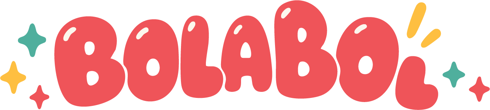
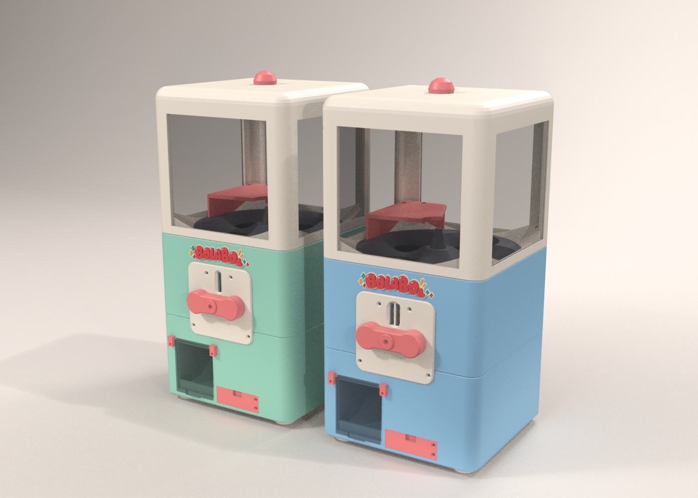
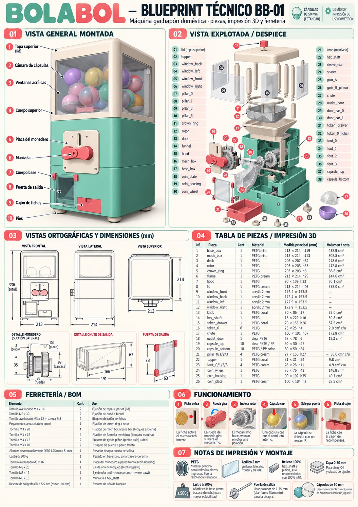

<p align="center"></p>

<p align="center">
  <a href="README.md">English</a> · <b>Català</b> · <a href="README.es.md">Español</a>
</p>

# BolaBol: gachapon amb moneda, imprimible en 3D

Màquina de càpsules sorpresa totalment imprimible en 3D. Posa una fitxa impresa, gira la manovella i cau una càpsula de 50 mm.
Disseny paramètric generat amb codi Python/Blender, amb STL i llits llestos per a una impressora de 220 × 220 mm.

<p align="center"></p>

## Característiques

- Càpsula de **50 × 54 mm**, en dues peces, també imprimible; n'hi caben **10**.
- **Amb fitxa**: roda de monedes + gatet de bloqueig + trinquet. La manovella només fa la volta si hi ha una fitxa de 25 × 4 mm. Validat amb una simulació dinàmica de ~200 casos (`codi/gacha/coin_battery.py`).
- Dues versions: **1 moneda** (menta) i **2 monedes** (blau cel, a `2monedes/`).
- **Quasi tot en PETG**, més finestres d'acrílic (tall làser o làmina transparent) i cargols M3. Mira [`BOM.md`](BOM.md).
- Peces de prova (engranatges, moneder) per validar la teva impressora abans de fer la màquina sencera.

## Blueprint

<p align="center"><a href="docs/blueprints/blueprint-bb01.jpg"></a></p>

Fitxes tècniques a [`docs/blueprints/`](docs/blueprints): blueprint general, despeç complet amb ferreteria i fitxa de la màquina i la moneda. Kit de marca (logo, paleta, tipografia, mascota, colors) a [`docs/brand/`](docs/brand).
Són il·lustracions de comunicació (en castellà). **[`BOM.md`](BOM.md) i els STL són la font de veritat** per a mides i ferreteria; el panell de "funcionament" del blueprint està simplificat (la màquina real és purament mecànica: sense microinterruptor ni sensor).

## Què hi ha

| Ruta | Contingut |
|---|---|
| [`imprimir/`](imprimir) | Cada peça ja orientada per imprimir, i a [`imprimir/llits/`](imprimir/llits) els **20 llits** llestos (3MF, Flash Forge AD5M Pro / Flash Studio) |
| [`stl/`](stl) | Cada peça tal com és al model, proves a `stl/proves/`, la insígnia a `bolabol_logo.3mf` |
| [`2monedes/`](2monedes) | Les 3 peces que canvien a la versió de 2 monedes |
| `BolaBol-v1*.blend` | Models de Blender: 1 moneda, 2 monedes, i les dues juntes |
| [`codi/`](codi) | El codi Python que genera el model (`gacha/`) i traça els logos (`brand/`) |
| [`docs/`](docs) | Renders i imatges del muntatge pas a pas de les proves |
| [`BOM.md`](BOM.md), [`BOM_2monedes.md`](BOM_2monedes.md) | Llista de peces, orientació, ferreteria i canvis del disseny |

## Com fer-la

1. **Imprimeix primer les peces de prova** (`stl/proves/`) amb la teva impressora i material. Si els engranatges engranen i el gatet bloqueja a mà, la màquina sencera també ho farà. Imatges del muntatge: [`docs/assembly/`](docs/assembly).
2. Imprimeix les peces: usa els llits de `imprimir/llits/` o els STL de `imprimir/`. Colors i quantitats a [`BOM.md`](BOM.md).
3. Aplega la ferreteria (cargols M3, molla de bolígraf, llast de 500 g, 4 vidres d'acrílic…), també a [`BOM.md`](BOM.md).
4. Imprimeix **30 monedes** (`imprimir/llits/llit_19_monedes.3mf`, unes 3 h).
5. Munta. L'ordre i els detalls de fixació són al BOM; els models 3D mostren com encaixa cada peça.

## Regenerar / modificar el model

Cal [Blender](https://www.blender.org/) (desenvolupat amb 5.1) i Python amb `numpy`; el traçat de logos necessita `Pillow` i `potrace`. El codi s'executa dins de Blender:

```python
import sys; sys.path.insert(0, "codi/gacha")
import build; build.main()                 # màquina d'1 moneda
# build.main(coins=2)                      # màquina de 2 monedes
```

Totes les mides són a [`codi/gacha/params.py`](codi/gacha/params.py). `export.py` escriu els STL i comprova que caben al llit i que són manifold. `print3mf.py` fa els llits i necessita l'addon FlashPrep (no inclòs).

## Llicència

[Creative Commons Reconeixement-NoComercial-CompartirIgual 4.0](LICENSE) (CC BY-NC-SA 4.0). Pots compartir i remesclar donant crèdit, sense ús comercial i amb la mateixa llicència. BolaBol, Boli, BBOL i els logos són obra original de Pau Avila.

Dubtes o una impressió per ensenyar? Obre un issue.
