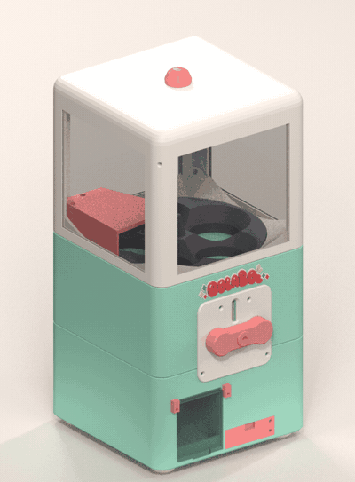

<p align="center"></p>

<p align="center">
  <b>English</b> · <a href="README.ca.md">Català</a> · <a href="README.es.md">Español</a>
</p>

# BolaBol: a 3D-printable coin-operated gachapon

A fully 3D-printable capsule-toy machine. Insert a printed token, turn the crank, and a 50 mm capsule drops out.
Parametric design generated by Python/Blender code, with print-ready STLs and bed plates for a 220 × 220 mm printer.

<p align="center"></p>

<p align="center"></p>

## Features

- Holds **10 capsules** (50 × 54 mm, two-piece, also printable).
- **Token-operated**: a coin wheel + blocking pawl + ratchet only lets the crank complete a turn if a 25 × 4 mm token is inserted. Validated with a ~200-case dynamic simulation (`codi/gacha/coin_battery.py`).
- Two versions: **1 token** (mint) and **2 tokens** (sky blue, in `2monedes/`).
- **Mostly PETG**, plus acrylic windows (laser cut or clear sheet) and M3 hardware. See [`BOM.md`](BOM.md).
- Print-tested test jigs (gears, coin mechanism) so you can validate your printer before committing to the full build.

## Blueprint

<p align="center"><a href="docs/blueprints/blueprint-bb01.jpg"></a></p>

Technical sheets in [`docs/blueprints/`](docs/blueprints): general blueprint, full exploded view with hardware, and the machine/token info card. Brand kit (logo, palette, typography, mascot, colorways) in [`docs/brand/`](docs/brand).
These are illustrations made for communication (in Spanish). **[`BOM.md`](BOM.md) and the STL files are the source of truth** for dimensions and hardware; the blueprint's "how it works" panel is simplified (the real machine is purely mechanical: no microswitch or sensor).

## What's inside

| Path | Content |
|---|---|
| [`imprimir/`](imprimir) | Every part already oriented for printing, plus [`imprimir/llits/`](imprimir/llits): **20 ready-to-slice bed plates** (3MF, Flash Forge AD5M Pro / Flash Studio) |
| [`stl/`](stl) | Every part as it sits in the model, test pieces in `stl/proves/`, the badge in `bolabol_logo.3mf` |
| [`2monedes/`](2monedes) | The 3 parts that change for the 2-token version |
| `BolaBol-v1*.blend` | Blender models: 1 token, 2 tokens, and both side by side |
| [`codi/`](codi) | Python source that generates the whole model (`gacha/`) and traces the logos (`brand/`) |
| [`docs/`](docs) | Renders, exploded-view GIF and step-by-step assembly pictures of the test jigs |
| [`BOM.md`](BOM.md), [`BOM_2monedes.md`](BOM_2monedes.md) | Parts list, print orientation, hardware, design changelog (in Catalan) |

## Build it

1. **Print the test jigs first** (`stl/proves/`) with your own printer and material. If the gears mesh and the pawl blocks by hand, the full machine will work. Assembly pictures: [`docs/assembly/`](docs/assembly).
2. Print the parts: use the ready plates in `imprimir/llits/`, or the individual STLs in `imprimir/`. Colors and quantities are in [`BOM.md`](BOM.md).
3. Gather the hardware (M3 screws, pen spring, 500 g ballast, 4 acrylic panes…), also in [`BOM.md`](BOM.md).
4. Print **30 tokens** (`imprimir/llits/llit_19_monedes.3mf`, about 3 h).
5. Assemble. Order and fastener details are in the BOM; the 3D models show how every part fits.

## Regenerate / modify the model

Requires [Blender](https://www.blender.org/) (developed with 5.1) and Python with `numpy`; logo tracing needs `Pillow` and `potrace`. The code runs inside Blender:

```python
import sys; sys.path.insert(0, "codi/gacha")
import build; build.main()                 # 1-token machine
# build.main(coins=2)                      # 2-token machine
```

All dimensions live in [`codi/gacha/params.py`](codi/gacha/params.py). `export.py` writes the STLs and checks bed fit and manifoldness. `print3mf.py` makes the bed plates and needs the FlashPrep add-on (not included).

## License

[Creative Commons Attribution-NonCommercial-ShareAlike 4.0](LICENSE) (CC BY-NC-SA 4.0). You may share and remix with credit, for non-commercial use, under the same license. BolaBol, Boli, BBOL and the logos are original artwork by Pau Avila.

Questions or a print to show off? Open an issue.
